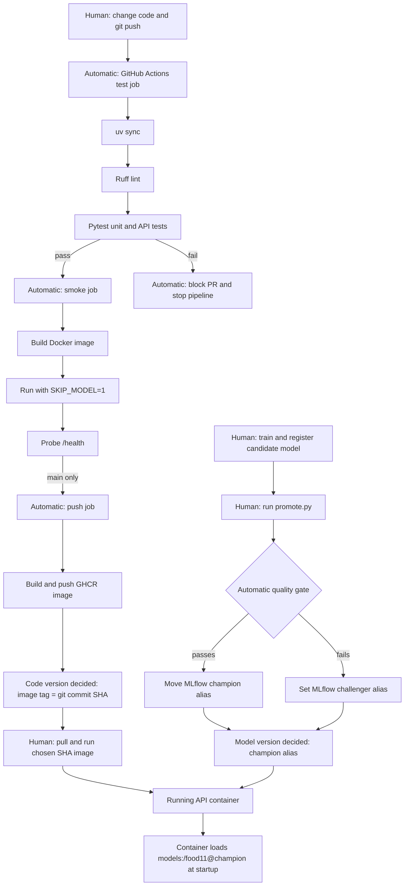

question1:

It makes the unit test slow and dependent on external infrastructure. It could fail even when the code is correct because:
- The MLflow server is unavailable or the network connection fails.
- The model is missing or changed.
- Required model artifacts cannot be downloaded.
- The runner lacks enough memory or compatible dependencies.

question2:

It proves the API can read an uploaded image, call the model, map the result to "Bread", and return valid JSON with a confidence value.
It does not prove the real model loads correctly, predicts accurately, or works with MLflow and production data.

question3:

The content-hash duplicate check caught it. A duplicate silently leaks test data into training, producing misleadingly high evaluation results. A corrupted image causes an obvious crash, while leakage can go unnoticed and lead to releasing a poor model.

question4:

In CI after dvc pull, when the runner has access to the DVC remote.
Before committing or pushing data, such as a local pre-commit/pre-push hook or data-ingestion pipeline.

question5:

With needs: test, smoke is skipped if tests fail. Without it, both jobs run independently and may run in parallel.

question6:

First successful run: 2m 19s
Second run: 3m 03s
No meaningful step became faster; uv sync was actually slower (25s vs 15s), likely runner/network variation. Docker caches are not shared between fresh runners by default.
CPU-only PyTorch configuration was added and pushed in commit 33c2184, removing all CUDA packages.

question7:

 A commit SHA is immutable and identifies the exact code version. With latest, Machine A may pull before a new image is published while Machine B pulls afterward, so both use latest but run different code.

question8:

 Explicit permissions give the token only required access: read repository contents and write packages. An unrestricted compromised step could modify code, releases, issues, workflows, or packages and potentially inject malicious software.

 question9:

 The PR shows the test check failed, while smoke and push were skipped. The PR cannot merge because branch protection requires successful checks.
For a team, this creates consistent, automatic enforcement. Merging no longer depends on each developer remembering to run tests or having an identical local environment.

question10:

- Version 3: 0.0949 < 0.6074 → challenger
- Version 4: 0.7628 ≥ 0.6074 → champion
Champion accuracy was 0.5776; with 1,096 test images, 2 × SE ≈ 0.0298, or 2.98 percentage points.

question11:
- Use a self-hosted GitHub runner on the machine/network hosting MLflow.
- Host MLflow publicly, such as with DagsHub, then run promotion from GitHub Actions using stored credentials.

question12:
# Lab 5 pipeline

The code and model are versioned independently. GitHub Actions automatically
tests, builds, smoke-tests, and publishes code as an image tagged with the
immutable commit SHA. A human still merges the protected pull request, chooses
which SHA to deploy, starts the production container, trains/registers model
candidates, and launches the promotion script. The promotion decision itself is
automatic: the quality gate moves either the `champion` or `challenger` alias.
The serving container resolves `champion` from MLflow when it starts.
